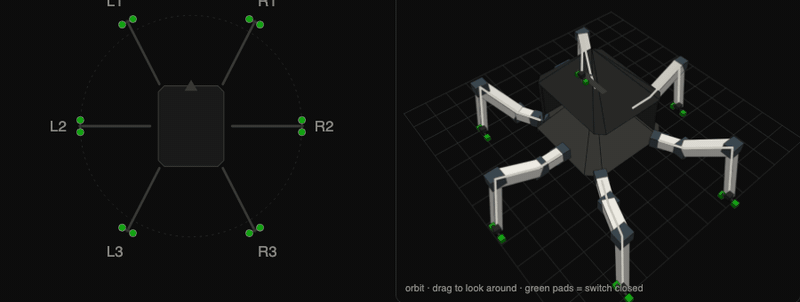
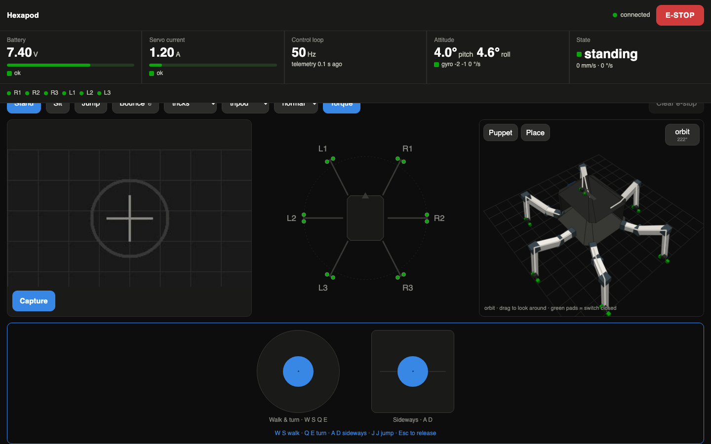
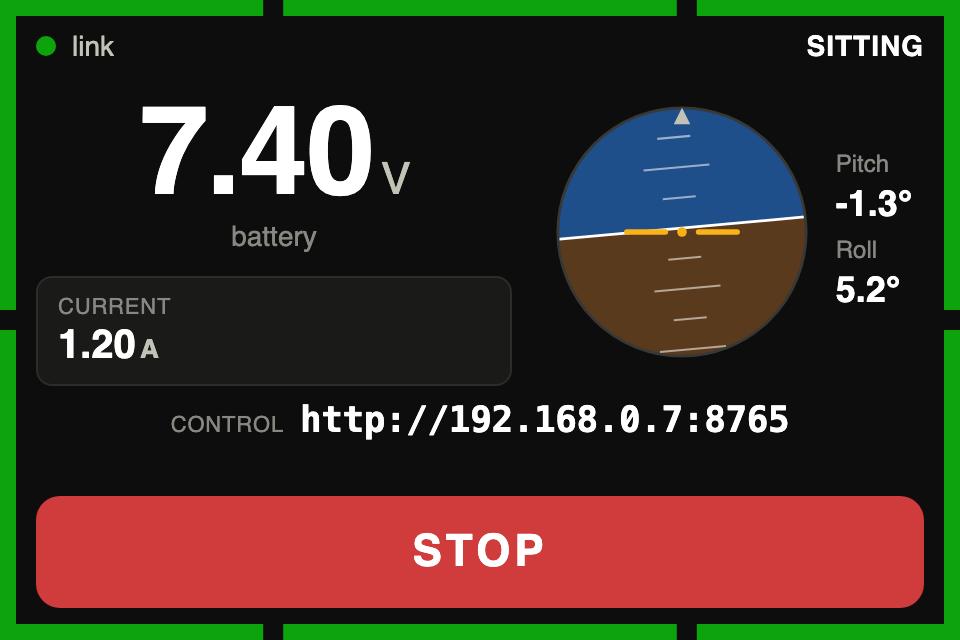

# pi-hexapod

[](https://github.com/C00kieMonsta/pi-hexapod/actions/workflows/tests.yml)
[](LICENSE)


A Raspberry Pi brain for the [MakeYourPet Chica](https://github.com/MakeYourPet/hexapod)
hexapod. It replaces the Chica Server and Chica Client Android apps with one
Python process on a Pi 5. The Pimoroni Servo2040 keeps its stock Chica
firmware. Everything above it moves to the Pi: inverse kinematics, gaits,
safety trips, camera, IMU, hand tracking, a browser client and a status screen
on the robot's roof.



## What it does

- Walks the Chica gait set (tripod, triple, ripple, wave) in three stance
  modes (normal, speed, offroad). Tricks: flex, axis leans, spin, dance,
  bounce and jump.
- Drives from any browser on the LAN. Pads or WASD, Space for e-stop.
- Shows the commanded pose in 3D and the live feet from above.
- Lets you pose one leg from the 3D view without jumping a servo.
- Follows your hand through a laptop camera with MediaPipe. Lean mode moves
  the body. Pincer mode drives the two front legs with two fingers.
- Lowers a stance foot until its micro switch closes.
- Streams the Pi camera as MJPEG and saves full-resolution stills with the
  robot's state beside each one.
- Runs a 480x320 roof panel: battery, current, horizon, foot switches, STOP.
- Latches e-stop on overcurrent, a stalled servo at a held pose, low voltage
  or lost telemetry. Velocity commands expire after 0.5 s.

## Try it without a robot

The dry run fakes the board, a rocking IMU and a camera. Every page and
endpoint works with nothing attached.

```sh
git clone https://github.com/C00kieMonsta/pi-hexapod.git && cd pi-hexapod
python3 -m venv .venv && .venv/bin/pip install -e '.[dev]'
tools/fetch-hand-assets.sh        # MediaPipe wasm and model for hand tracking
.venv/bin/hexapod --dry-run serve
```

Open the URL it prints and accept the self-signed certificate once. The laptop
camera needs https on anything but localhost. `/` is the operator client,
`/status` is the roof panel. Press Torque, then Stand, then click the pad
block and hold W. `--no-hand` turns hand tracking off, `--no-tls` serves plain
HTTP.

The tests need no hardware either: `.venv/bin/pytest`.





## How it fits together

```
browser on the LAN  --wifi-->  Pi  --USB serial-->  Servo2040  -->  18 servos
joystick, sliders   /          |   --i2c-------->  GY-521 IMU
480x320 panel   ---            |   --CSI--------->  camera
                        one FastAPI process: IK, gait, state, MJPEG
```

One process owns the hardware. The serial port, the i2c bus and the camera
can each be opened by a single process, so `hexapod serve` holds all three and
both pages (`/` for the operator, `/status` for the panel) are plain HTTP
clients of it. The control loop runs at 50 Hz on its own thread. Velocity
comes from named sources with priorities, so a vision behaviour is one more
call to `Controller.command`, with no change to the loop.

## Build one

| Part | This build |
|---|---|
| Frame and legs | MakeYourPet Chica, printed from [its STLs](https://github.com/MakeYourPet/hexapod/tree/main/STL) |
| Electronics body | [assets/print-me/body/](assets/print-me/body/), a CadQuery script and its STLs |
| Servos | 18 x Feetech FT5330M |
| Servo controller | Pimoroni Servo2040 running [chica-servo2040-simpleDriver](https://github.com/EddieCarrera/chica-servo2040-simpleDriver) |
| Computer | Raspberry Pi 5 |
| IMU | GY-521 (MPU-6050) on i2c |
| Camera | Raspberry Pi Camera Module 3 Wide |
| Screen | Waveshare 3.5" RPi LCD (F), 320x480 ST7796S, mounted sideways |
| Foot sensing | A micro switch in each foot tip |
| Power | 2S LiPo on XT60, a UBEC at 5.2 V for the Pi, a relay on the servo rail |

[docs/build.md](docs/build.md) goes from a bare Pi to the first walk:
install, preflight, finding the board, centring and fitting the servos, joint
directions, then the neutral stance. Every hardware problem hit along the way
is in [docs/troubleshooting.md](docs/troubleshooting.md), including the
diagnoses that turned out wrong; the i2c one was believed for weeks.

## Docs

| Doc | What is in it |
|---|---|
| [docs/build.md](docs/build.md) | Install, preflight, bring-up, deploy as a service, configuration |
| [docs/operating.md](docs/operating.md) | The web client, the roof panel, the camera, the safety layer |
| [docs/imu.md](docs/imu.md) | Wiring, checking and calibrating the GY-521 |
| [docs/api.md](docs/api.md) | HTTP and WebSocket endpoints, adding a command source, the Servo2040 wire protocol |
| [docs/troubleshooting.md](docs/troubleshooting.md) | The bring-up log: symptom, cause, fix |
| [docs/writeup.md](docs/writeup.md) | The story of the build |

## Layout

| Path | What it does |
|---|---|
| [hexapod/protocol.py](hexapod/protocol.py) | Chica wire format. Pure functions, no IO. |
| [hexapod/board.py](hexapod/board.py) | Serial thread, telemetry, watchdog. `FakeBoard` for dry runs. |
| [hexapod/kinematics.py](hexapod/kinematics.py) | Body pose and 3-DOF leg IK. |
| [hexapod/gait.py](hexapod/gait.py) | Walk catalog and bounce/jump overlays. |
| [hexapod/mode.py](hexapod/mode.py) | Stance presets: normal, speed, offroad. |
| [hexapod/controller.py](hexapod/controller.py) | 50 Hz control loop and gait state. |
| [hexapod/imu.py](hexapod/imu.py) | MPU-6050 over i2c. Bias calibration, pitch and roll. `FakeImu` for dry runs. |
| [hexapod/camera.py](hexapod/camera.py) | Owns `Picamera2`. Live stream and stills. `FakeCamera` for dry runs. |
| [hexapod/webcam.py](hexapod/webcam.py) | Optional USB cam for `/hand/stream`. `--webcam`. |
| [hexapod/hand.py](hexapod/hand.py) | MediaPipe Hands → `POSE_LIMITS`. on with `serve`; `--no-hand` off. |
| [hexapod/state.py](hexapod/state.py) | Polls the IMU at 10 Hz and merges board, gait, IMU, camera and network into one snapshot. |
| [hexapod/net.py](hexapod/net.py) | Which addresses the server is reachable at. |
| [hexapod/server.py](hexapod/server.py) | HTTP, MJPEG and WebSockets. |
| [hexapod/static/index.html](hexapod/static/index.html) | The client. One file, no build step, no CDN. |
| [hexapod/static/status.html](hexapod/static/status.html) | The 320x480 panel page. |
| [config/hexapod.yaml](config/hexapod.yaml) | Servo channels, calibration, geometry, stance, safety thresholds. |
| [deploy/](deploy/) | systemd units, kiosk launcher, installer. |
| [tools/poke.py](tools/poke.py) | Standalone link test; `--census` maps headers to joints by eye, `--probe` finds dead headers by current. Only needs pyserial. |
| [tools/i2cwatch.py](tools/i2cwatch.py) | Rolling i2c success rate. Finds a loose IMU lead. No dependencies. |
| [tools/imucal.py](tools/imucal.py) | Six-position accelerometer check: offset and scale per axis, and `imu.axis_map`. No dependencies. |
| [tools/servolog.py](tools/servolog.py) | Prints every servo that moves while you press buttons, and a summary. Stdlib only. |
| [tools/preflight.py](tools/preflight.py) | Checks env, config, maths, IMU, camera and board in one run. |
| [tools/sync.sh](tools/sync.sh) | rsync the working tree to the Pi over ssh. |
| [assets/print-me/](assets/print-me/) | Printable leg parts and the electronics body. |

## Credits

- [MakeYourPet](https://github.com/MakeYourPet/hexapod) designed the Chica
  frame and legs. The servo channels and calibration in
  [config/hexapod.yaml](config/hexapod.yaml) are ported from its
  `chica-config-2040.txt`.
- [Eddie Carrera's chica-servo2040-simpleDriver](https://github.com/EddieCarrera/chica-servo2040-simpleDriver)
  is the Servo2040 firmware, run unchanged, and the source of the serial protocol.
- [MediaPipe](https://github.com/google-ai-edge/mediapipe) provides the hand
  landmarker.

Their licenses are in [THIRD_PARTY_NOTICES.md](THIRD_PARTY_NOTICES.md).

## License

MIT, copyright Antoine Boxho and Fin Warman. See [LICENSE](LICENSE).
Issues and pull requests are welcome; [CONTRIBUTING.md](CONTRIBUTING.md) says
how to run the tests and what a change needs. If you build one, open an issue
with a photo.
